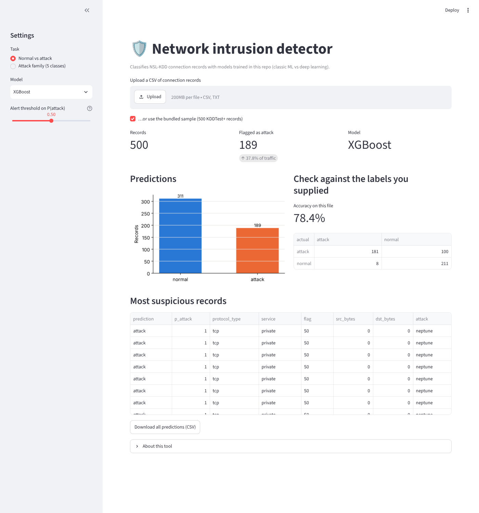
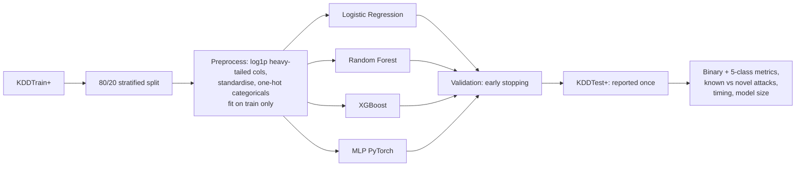
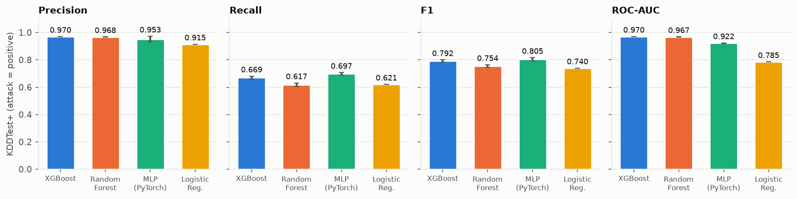
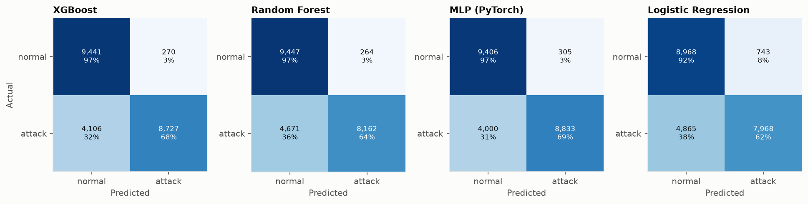
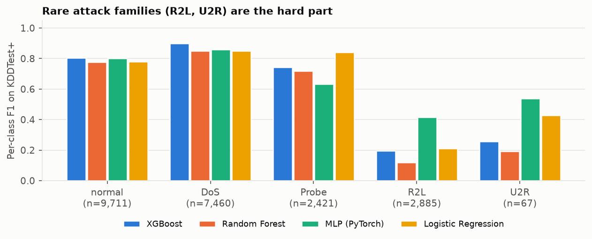
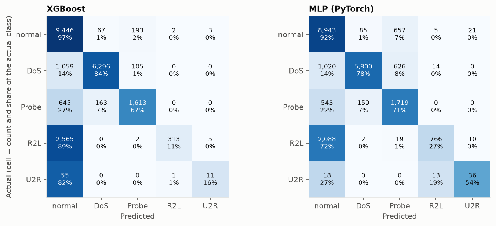
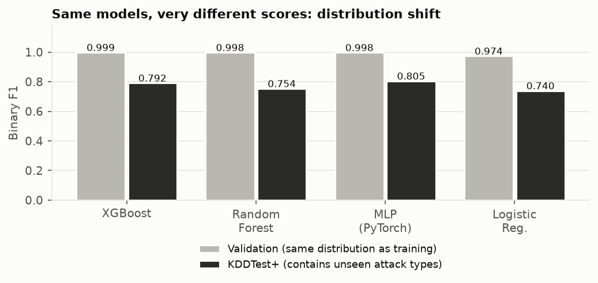
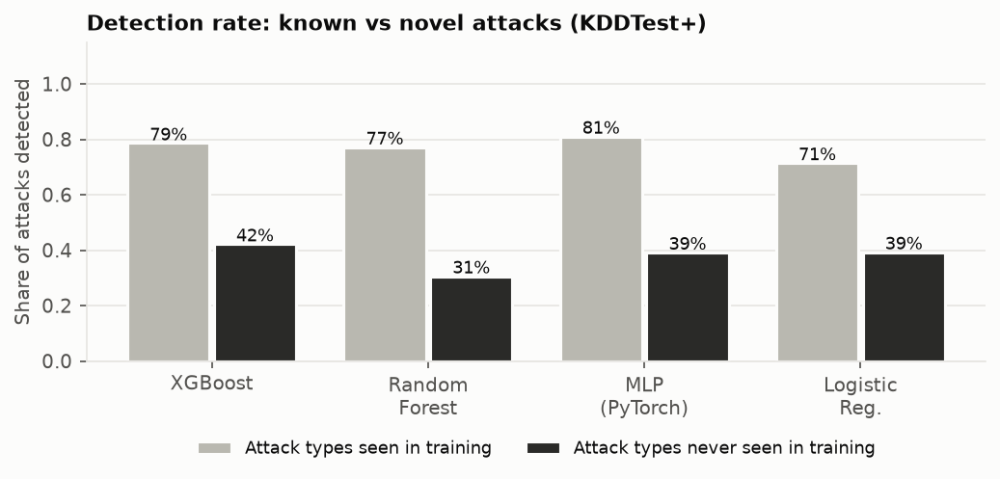
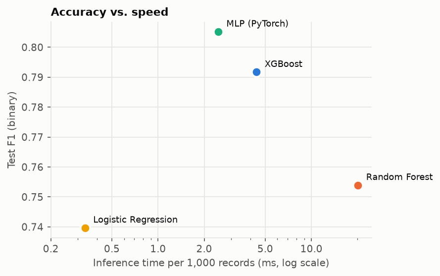
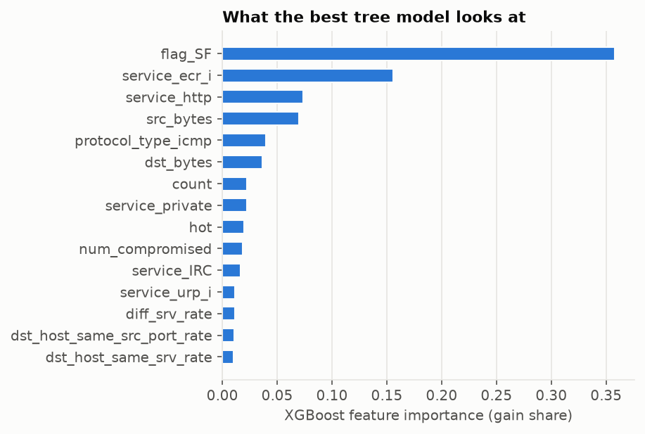

# Network Intrusion Detection on NSL-KDD: Machine Learning vs Deep Learning

> **Can a model trained on known attacks catch new ones?** A controlled comparison of Logistic Regression, Random Forest, XGBoost and a PyTorch MLP for network intrusion detection, evaluated on the official hold-out set that deliberately contains attack types never seen in training. Includes a Streamlit app that classifies an uploaded CSV of connection records.

**[Live demo](https://nsl-kdd-ids-demo.streamlit.app/)** (free hosting: if the app has been idle it takes about 30 seconds to wake up)



## Headline findings

1. **Validation scores are almost useless here.** Every model reaches **F1 ≈ 0.998** on a random validation split but only **0.74-0.81** on the official test set. The test set contains 17 attack types absent from training, so what a random split measures is memorisation, not detection.
2. **Novel attacks are the real problem.** Models detect **71-81 %** of attacks whose type was seen in training but only **31-42 %** of attacks whose type was not.
3. **ML vs DL is a trade-off, not a winner.** XGBoost has the best precision (0.970) and ranking quality (ROC-AUC 0.970). The MLP matches it on binary F1 (0.805 vs 0.792, about one standard deviation apart) and is clearly better on the **rare attack families** (R2L, U2R), giving the best 5-class macro-F1 (0.641 vs 0.579).
4. Random Forest is the slowest at inference (20.1 ms per 1,000 records vs 2.5 ms for the MLP) and, apart from a marginally lower false-positive rate than XGBoost (0.027 vs 0.028), is not better on any metric measured here.

## Data

[NSL-KDD](https://www.unb.ca/cic/datasets/nsl.html) (Canadian Institute for Cybersecurity), a cleaned-up version of KDD Cup 99 with duplicate records removed. 41 features per connection record (protocol, service, flag, byte counts, error rates, host-based traffic statistics) and an attack label.

| | Records | Normal | DoS | Probe | R2L | U2R |
|---|---|---|---|---|---|---|
| Train (80 % of `KDDTrain+`) | 100,778 | 53,874 | 36,742 | 9,324 | 796 | 42 |
| Validation (20 %, stratified by attack name) | 25,195 | 13,469 | 9,185 | 2,332 | 199 | 10 |
| **Test (`KDDTest+`, never touched until the end)** | 22,544 | 9,711 | 7,460 | 2,421 | **2,885** | 67 |

Note how R2L jumps from 1 % of training to 13 % of test: the test distribution is intentionally different. 3,750 of the 12,833 test attacks (29 %) belong to the 17 attack types that do not appear in training at all (`apache2, httptunnel, mailbomb, mscan, named, processtable, ps, saint, sendmail, snmpgetattack, snmpguess, sqlattack, udpstorm, worm, xlock, xsnoop, xterm`).

`python -m ids.data` downloads the two files (22 MB, not committed) from a public GitHub mirror of the original dataset.

## Method



- **Two tasks:** binary (normal vs attack) and 5-class (normal / DoS / Probe / R2L / U2R).
- **Preprocessing** (122 features after encoding): `log1p` on `duration`, `src_bytes`, `dst_bytes` (extremely heavy-tailed); standard scaling; one-hot encoding of `protocol_type`, `service`, `flag` with `handle_unknown="ignore"` because the test set contains services never seen in training. The preprocessor is fitted on the training split only.
- **Class imbalance:** all four models get the same square-root inverse-frequency class weights (sample weights for the sklearn/XGBoost models, a weighted loss for the MLP), so the comparison is not confounded by one model getting special treatment.
- **Models:** Logistic Regression; Random Forest (100 trees); XGBoost (up to 400 trees, depth 6, early stopping on validation); MLP 122 → 128 → 64 → output with BatchNorm, ReLU, dropout 0.3, AdamW and early stopping on validation loss.
- **Seeds:** the three stochastic models are trained with 3 seeds; tables show mean ± std. The data split is fixed.
- **Metrics:** accuracy, precision, recall, F1 (attack = positive class), ROC-AUC, false-positive rate, confusion matrices, per-class F1, inference time per 1,000 records, model size.

## Results

All numbers are on `KDDTest+` (22,544 records).

### Binary: normal vs attack

| Model | Accuracy | Precision | Recall | F1 | ROC-AUC | FPR | ms / 1k records | Size (MB) |
|---|---|---|---|---|---|---|---|---|
| XGBoost | 0.800 ± 0.007 | **0.970** ± 0.001 | 0.669 ± 0.012 | 0.792 ± 0.008 | **0.970** ± 0.001 | 0.028 ± 0.000 | 4.4 | 0.24 |
| Random Forest | 0.771 ± 0.007 | 0.968 ± 0.001 | 0.617 ± 0.013 | 0.754 ± 0.010 | 0.967 ± 0.002 | **0.027** ± 0.000 | 20.1 | 1.70 |
| MLP (PyTorch) | **0.808** ± 0.011 | 0.953 ± 0.020 | **0.697** ± 0.009 | **0.805** ± 0.011 | 0.922 ± 0.002 | 0.046 ± 0.020 | 2.5 | 0.11 |
| Logistic Regression | 0.751 | 0.915 | 0.621 | 0.740 | 0.785 | 0.077 | 0.3 | <0.01 |




Reading the table: the trees are **more precise** (3 % of normal traffic flagged vs 6 % for the MLP) and rank traffic better (AUC), while the MLP **catches slightly more attacks** at the default 0.5 threshold. Because F1 depends on that threshold, the similar F1 values do not mean the models are equivalent; for a real deployment the threshold should be tuned to the cost of a false alarm vs a missed attack (the app has a slider for this).

### 5-class: attack family

| Model | Accuracy | Macro precision | Macro recall | Macro F1 | Weighted F1 |
|---|---|---|---|---|---|
| XGBoost | 0.782 ± 0.001 | 0.813 ± 0.002 | 0.550 ± 0.003 | 0.579 ± 0.004 | 0.748 ± 0.002 |
| Random Forest | 0.747 ± 0.001 | 0.787 ± 0.003 | 0.510 ± 0.001 | 0.533 ± 0.002 | 0.709 ± 0.000 |
| MLP (PyTorch) | 0.769 ± 0.011 | 0.742 ± 0.016 | **0.641** ± 0.003 | **0.641** ± 0.025 | **0.754** ± 0.018 |
| Logistic Regression | 0.766 | 0.772 | 0.603 | 0.623 | 0.736 |



The gap between MLP and trees comes almost entirely from the two rare families: on R2L the MLP reaches F1 0.42 vs 0.20 (XGBoost), and on U2R 0.54 vs 0.26 (seed-0 models; the figure above shows the same). **Caution:** U2R has only 67 test records, so its F1 is noisy; the macro-F1 difference (0.641 ± 0.025 vs 0.579 ± 0.004, three seeds) is larger than the seed variation, but it comes from a single train/test split.



### Generalisation: why validation lies




| Model | Val F1 | Test F1 | Detection: known attack types | Detection: novel attack types |
|---|---|---|---|---|
| XGBoost | 0.999 | 0.792 | 78.7 % | 42.2 % |
| Random Forest | 0.998 | 0.754 | 77.2 % | 30.6 % |
| MLP (PyTorch) | 0.998 | 0.805 | 81.1 % | 39.2 % |
| Logistic Regression | 0.974 | 0.740 | 71.5 % | 39.3 % |

(known/novel detection: seed-0 models, share of attack records classified as attack.) Even for *known* types, detection is only about 80 %: the test set also shifts the mix and variants within known families.

### Speed vs accuracy



Training time on a Windows laptop CPU (timings vary with hardware): Logistic Regression 5 s, Random Forest 10 s, XGBoost 13 s, MLP 73 s (per model, binary task). All are small enough to retrain in seconds to minutes; the choice should be driven by accuracy and error cost, not compute.

### What the best tree model looks at



## Streamlit app

```bash
streamlit run app/streamlit_app.py
```

Upload a CSV (header optional; either the 41 NSL-KDD feature columns, or a raw 41-43 column NSL-KDD file) and choose the task, model and alert threshold. The app shows how many records are flagged, a table of the most suspicious ones, accuracy and a confusion table if a `label` column is present, and lets you download all predictions. `sample_data/sample_traffic.csv` has 500 `KDDTest+` records to try it with.

## Quickstart

```bash
git clone https://github.com/shubham-patel-7/nsl-kdd-intrusion-detection.git
cd nsl-kdd-intrusion-detection
python -m venv .venv && source .venv/bin/activate      # Windows: .venv\Scripts\activate
pip install -r requirements.txt && pip install -e .

python -m ids.data        # download NSL-KDD (22 MB)
python -m ids.train       # ~8-10 min on a laptop CPU; writes models/ and results/metrics.json
python -m ids.report      # figures + results tables
pytest -q                 # 11 tests
streamlit run app/streamlit_app.py
```

Trained models are committed in `models/` (5 MB), so the app works right after install. If you upgrade scikit-learn and loading a `.joblib` fails, re-run `python -m ids.train`. `make all` runs everything.

## Repository layout

```
src/ids/
  config.py     schema, attack-name -> family map, paths
  data.py       download, load, labels, preprocessing pipeline, class weights, split
  models.py     PyTorch MLP + model factory (LogReg / RF / XGBoost / MLP)
  evaluate.py   metrics, confusion matrices, inference timing
  train.py      trains everything for both tasks, saves models + metrics
  predict.py    CSV reader/validator + Detector used by the app
  report.py     figures and tables
app/streamlit_app.py
tests/test_ids.py         schema, no-unmapped-labels, dataset sizes, unseen-category handling, class weights, MLP learns, metrics, CSV parsing, end-to-end app run
sample_data/sample_traffic.csv
results/                  metrics.json, results_tables.md, figures/
```

## Limitations

- **NSL-KDD is old and synthetic-ish** (derived from 1999 DARPA traffic). Results say how methods behave under distribution shift, not how they would perform on a modern network. A natural next step is CIC-IDS2017/2018.
- **One train/validation split and one official test set**; seed variation is reported, split variation is not.
- Hyper-parameters were set by hand (early stopping on validation) and not searched; a tuned model could change the ranking.
- The **0.5 decision threshold** is not tuned; precision/recall trade-offs would shift with it.
- Per-class results for U2R rest on 67 test records.

## Improvements I would make next

1. Tune the decision threshold on validation data against an explicit false-alarm vs missed-attack cost.
2. Add an anomaly-detection model (autoencoder / one-class) and compare it with the supervised models specifically on novel attack types.
3. Evaluate on CIC-IDS2017 to see whether the ranking survives modern traffic.
4. Explain predictions with SHAP and check whether the MLP and XGBoost rely on different features.
5. Calibrate probabilities (isotonic / temperature scaling) so `P(attack)` can be read literally.

## References

- M. Tavallaee, E. Bagheri, W. Lu, A. Ghorbani, *A Detailed Analysis of the KDD CUP 99 Data Set*, IEEE CISDA 2009.
- Canadian Institute for Cybersecurity, NSL-KDD dataset.

## License

MIT (see `LICENSE`).


---

## Demo runs and result analysis

Three runs of the app's "upload a CSV" flow using the saved models (`python scripts/demo_runs.py`; raw numbers in `results/demo_runs.json`). The script writes three upload files to `sample_data/` that you can also upload in the Streamlit app. All records come from **KDDTest+**, which the models never saw in training. The files contain no labels; labels are used only to score the output.

| Demo run (upload file) | Model | Records | Flagged as attack | Detection rate | False-alarm rate | Mean confidence |
|---|---|---|---|---|---|---|
| 1. Mixed traffic (`demo_mixed.csv`: 578 attacks, 422 normal) | XGBoost | 1,000 | 421 (42.1%) | 70.1% | 3.8% | 0.98 |
| | MLP (PyTorch) | 1,000 | 419 (41.9%) | 69.4% | 4.3% | 0.98 |
| 2. Attack types seen in training (`demo_known_attacks.csv`) | XGBoost | 500 | 391 (78.2%) | 78.2% | - | 0.99 |
| | MLP (PyTorch) | 500 | 407 (81.4%) | 81.4% | - | 0.97 |
| 3. Attack types never seen in training (`demo_novel_attacks.csv`) | XGBoost | 500 | 209 (41.8%) | 41.8% | - | 0.92 |
| | MLP (PyTorch) | 500 | 203 (40.6%) | 40.6% | - | 0.97 |

**What the three runs show**

1. **Run 1 reproduces the headline results.** A random 1,000-record sample gives about 70% detection and 4% false alarms, in line with the full-test-set recall of 0.67 to 0.70 and false-positive rate of 0.03 to 0.06. The false-alarm rate is a little above the 2.8% on the full set, but with 422 normal records that is only about 4 extra records, which is sampling noise.
2. **The aggregate hides where the misses are.** In run 1, XGBoost caught 89% of DoS (n=341) and 77% of Probe attacks (n=104) but only **15% of R2L attacks (n=131)**. R2L records are 23% of the attacks yet make up **111 of the 173 missed attacks (64%)**. R2L attacks (remote password guessing and similar) look like ordinary logins at the connection level, so a detector built on these features struggles with them. U2R had only 2 records in the sample, too few to read anything from.
3. **Run 3 is the biggest gap: roughly 35 to 40 points lower detection for unseen attack types** (42% vs 78% for XGBoost, 41% vs 81% for the MLP). The two models are close to each other here, so changing the algorithm does not fix it.
4. **"Novel" is not uniformly invisible.** For XGBoost, `apache2` (a DoS variant, n=105) was caught 85% of the time and `saint` (a probe, n=31) 100%, because they resemble known DoS and Probe traffic. `snmpguess`, `snmpgetattack`, `httptunnel` (all R2L) and `mailbomb` (DoS) were caught 0% of the time (n=52, 19, 15 and 39), and `mscan` and `processtable` about 39% and 37%. Detection depends on how similar the new attack is to something the model has seen.
5. **Confidence cannot warn you about novelty.** Mean confidence is 0.92 (XGBoost) and 0.97 (MLP) on the novel attacks versus 0.99 and 0.97 on known ones. The models are almost as sure of themselves when they miss, so "only alert when unsure" is not a usable safety net here. A real deployment would need anomaly detection (for example an autoencoder trained on normal traffic) alongside the classifier.

**Caveats.** One saved model per algorithm and fixed random samples (seeds in the script); per-attack percentages with n between 15 and 52 are rough. NSL-KDD is derived from 1999 traffic, so the lesson (validation scores overstate performance on unseen attacks) transfers better than the exact numbers.
